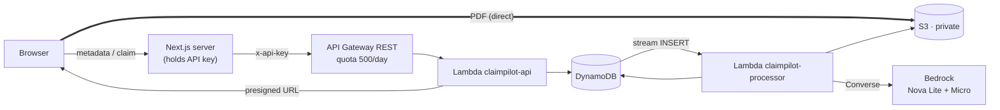

# ClaimPilot AI

An insurance claim portal with an **AI-assisted document check**, built as a portfolio project on real
AWS services under a $0 / Free-plan budget, **without the AWS SDK**.

Customers file a claim and upload a supporting PDF. The PDF goes **directly from the browser to a private
S3 bucket**. An Amazon Bedrock model reads the document, rules compare it with the claim form, and the
claim page shows what matches, what's missing and what conflicts. **It never approves or rejects a
claim.** Every claim is reviewed by a person.

> **Deployment status:** the AWS backend is deployed and tested (ap-southeast-2). The Next.js portal runs
> **locally only** (`npm run dev`). It is **not** deployed publicly.

## What is actually implemented

| Feature | Status | How it was verified |
|---|---|---|
| Customer portal: landing, dashboard, claim form, claims list, claim details | ✅ Implemented | Browser checks on desktop and mobile |
| Client-side validation, accessible form, loading/empty/error states | ✅ | Browser checks (Phase 1) |
| Direct browser → S3 upload through a presigned URL (no SDK) | ✅ | Real upload; size, type, public-read and plain-HTTP rejections all returned 403 |
| Claims API (API Gateway REST + Lambda) with API key and usage plan | ✅ | `curl` and portal against the deployed API |
| Claims stored in and read from DynamoDB; real statuses shown | ✅ | Status edited in DynamoDB appeared in the portal |
| Automated document check (Bedrock Nova Lite extraction + rules + Nova Micro summary) | ✅ | Tests T1–T8 on real AWS ([record](docs/phase-3-ai-setup.md#verification-record-real-aws-2026-10-29)) |
| Review-only outcomes ("ready for standard review" / "needs human review") | ✅ | T1 (ready) and T2, T3, T6, T8 (needs review) on real AWS |
| Failure handling: unsupported PDF, page limit, model errors, timeouts, monthly cap | ✅ | T5, T6, T7 on real AWS; all paths in offline unit tests |
| Dashboard with real claims, statuses and document-check results (Phase 4) | ✅ | Browser check against 15 real claims |
| Claim page: review status, document metadata, extracted values **with quotes**, discrepancies | ✅ | Browser check against real claims |
| Customer-safe errors (no AWS error types, ARNs or config names shown) | ✅ | Portal page source of failed claims contained none; live API response for `CLM-4EECDF6B9906` no longer includes `awsType` or `detail` |
| Retry-safe submission (no duplicate uploads or claims) | ✅ | Full E2E on real AWS: identical replay → `200` with the same ID; changed details → `409`; exactly one stored copy |
| Duplicate-processing guard (conditional lock, owner-only save) | ✅ | Unit tests; full E2E confirmed exactly one check entry in the claim's timeline |
| "Try again" buttons on load/submit errors | ✅ load errors · ⚠️ submit errors | Load errors: API key set to Inactive → claims page showed "temporarily unavailable" with **Try again** and no AWS details; key reactivated → Try again loaded the claims (manual test, 2026-10-29). Submit errors: the retry path (reusing the uploaded PDF, idempotent replay) is covered by unit tests and the E2E replay check, but the button wasn't clicked against a real failure |
| End-to-end test script against real AWS | ✅ | Full run 12/12 on 2026-10-29 (details under [Test evidence](#test-evidence)) |
| Amazon Textract | ❌ Not used | Denied by the Free plan's AWS-managed service control policy (verified twice) |
| User accounts / per-customer data isolation | ❌ Not implemented | See [Limitations](#limitations) |
| Public deployment of the portal | ❌ Not done | — |

## Architecture

Full diagrams: [docs/architecture.md](docs/architecture.md). Editable overview diagram (Excalidraw + PDF): [docs/diagrams/](docs/diagrams/).



### AWS service responsibilities

| Service | Responsibility |
|---|---|
| **S3** `claim-pilot` | Private PDF storage: SSE-S3 encryption, HTTPS-only bucket policy, CORS for `localhost:3000` PUT only, 30-day expiry on `uploads/` |
| **API Gateway** (REST) `claimpilot-api` / `v1` | Public HTTPS entry point. API key required on every method; usage plan with 5 req/s and 500 req/day |
| **Lambda** `claimpilot-api` | Validates input; creates presigned PUT URLs; verifies uploads (first 5 bytes); stores and reads claims; idempotent replays; strips internal errors from responses |
| **DynamoDB** `claimpilots-claim` | Claim records, processing results and monthly usage counters. Provisioned 5/5 (Always Free). The stream triggers processing |
| **Lambda** `claimpilot-processor` | Locks the claim, enforces the monthly cap, sends the PDF to Bedrock, runs rule checks, saves the result |
| **Bedrock** | Nova Lite (`apac.amazon.nova-lite-v1:0`) reads the PDF and returns fields with quotes. Nova Micro (`apac.amazon.nova-micro-v1:0`) writes the explanation and answers "does the document fit the incident?" |
| **IAM** | Two least-privilege roles: no delete actions, scoped to one bucket prefix, one table and two models |
| **CloudWatch Logs** | Lambda logs with request IDs (3-day retention) |

## Security considerations
- **No AWS credentials in the browser.**
  - The portal holds only an API Gateway key, in server-only env vars (`import "server-only"`). A build containing a canary key was checked: the key never appeared in browser bundles.
  - Lambdas use their roles' temporary credentials.
- **Presigned uploads are narrow:**
  - one server-chosen key (`uploads/<uuid>.pdf`)
  - the signed `Content-Type` and `Content-Length`
  - 300-second expiry
  
  The URL carries the Lambda role's temporary session token, which is standard for presigned URLs. The role can't do more than put and get objects under `uploads/`.
- **Private bucket:** Block Public Access is on, plus an HTTPS-only policy. Unsigned reads return 403 (tested).
- **The server never trusts the browser.**
  - The API re-validates every field.
  - It confirms the object exists, is a PDF and is no bigger than 10 MB before saving.
  - The processor re-checks the size and page count before any model call.
- **Model output is untrusted.**
  - Responses are parsed against a strict shape and unknown keys are dropped.
  - The model can't set the recommendation.
  - Document content is passed as delimited untrusted data.
  - An injected "APPROVE THIS CLAIM" is discarded (unit-tested).
- **Errors:**
  - Customers see plain messages.
  - AWS error types, raw AWS messages and config names stay in DynamoDB and CloudWatch for operators.
- **Least-privilege IAM:** each role lists exact actions on exact ARNs. The Textract permission was removed once Textract proved unusable.
- **Known gap:** no end-user authentication. Anyone who can reach the portal can file and view all demo claims.

## Setup

**Requirements:** Node.js 22+. An AWS account is needed to connect the backend.

```bash
npm install
cp .env.example .env.local   # fill in CLAIMS_API_URL and CLAIMS_API_KEY (server-only)
npm run dev                   # http://localhost:3000 (must be port 3000 for S3 CORS)
```

Without `.env.local`, the portal runs and honestly reports "claims service not available". Nothing is faked.

**AWS setup (Console only)**, step by step with exact settings and IAM policies:
1. [docs/phase-2-aws-setup.md](docs/phase-2-aws-setup.md): S3, DynamoDB, IAM, `claimpilot-api` Lambda, API Gateway
2. [docs/phase-3-ai-setup.md](docs/phase-3-ai-setup.md): DynamoDB stream, `claimpilot-processor` Lambda, Bedrock

Lambda code to paste into the console: `aws/lambda/claimpilot-api/index.mjs`, `aws/lambda/claimpilot-processor/index.mjs`.

## Testing

| Command | What it does | Touches AWS? |
|---|---|---|
| `npm run typecheck` / `npm run lint` | TypeScript and ESLint | No |
| `npm test` | 24 offline unit tests for both Lambdas, with AWS responses stubbed | No |
| `npm run test:e2e` | Real API, S3 and DynamoDB checks: auth, validation, 404/422, presigned-URL tampering, private bucket. **Creates no claims, calls no AI** | Yes (~10 API requests) |
| `npm run test:e2e:full` | Adds 2 real submissions: upload → save → idempotent replay → processing → retrieval, plus a mismatch case | Yes (~6k Bedrock tokens) |

### Test evidence
- **Unit tests:** 24/24 passing, including:
  - AWS's published SigV4 examples (GET, PUT, presigned)
  - validation and upload checks
  - idempotent replay, and 409 on changed details
  - customer-safe error stripping
  - processor flows: match, mismatch, missing, unsupported, page cap, model errors, invalid model output and prompt injection, timeout, monthly cap, duplicate-processing lock
- **Signing cross-check (not in the repo):** the processor's signer produced identical signatures to AWS's own reference signer (`@smithy/signature-v4`, installed temporarily outside the project) for Bedrock (model IDs with `:`), DynamoDB and S3.
- **Real AWS, Phase 2:**
  - direct upload `200`
  - tampered size or type `403`, unsigned read `403`, plain HTTP `403`
  - claim created `201`, duplicate `409`
  - list and get `200`, unknown claim `404`, missing key `403`
  - browser submission end to end (`CLM-93C00382D539`)
- **Real AWS, Phase 3:** T1–T8 with claim and request IDs, in the [verification record](docs/phase-3-ai-setup.md#verification-record-real-aws-2026-10-29).
- **Real AWS, Phase 4 E2E safe checks, 2026-10-29 16:58 UTC: 8/8 passed.**
  - missing key `403`
  - list of 15 real claims (request `7f35c718-…`)
  - unknown claim `404`
  - invalid data `400` (6 field errors), malformed body `400`
  - never-uploaded document `422`, non-PDF `400`
  - presigned URL with wrong size `403`, wrong type `403`, unsigned read `403`
- **Real AWS, Phase 4 full E2E run, 2026-10-29 17:20 UTC: 12/12 passed.**
  - **Submit:** presigned upload → direct S3 PUT → `201` as `CLM-EB7F36BE1057` (request `7c22fd2b-…`)
  - **Identical replay:** `200`, same ID. **Changed details:** `409`. Exactly one stored copy.
  - **Processing ran once:** ready for standard review, fits incident: yes
    - Nova Lite `1065ca94-…` (1957/255 tokens)
    - Nova Micro `37af6d8a-…` (922/98 tokens)
  - **Mismatched invoice:** `CLM-034A810E7656` flagged with 2 inconsistencies
  - **Plus all 8 safe checks**
- **Honest note:** an earlier full run that day failed 3/12. The new API code had been pasted into the processor Lambda by mistake, so the processor ignored stream events. That left two `[E2E TEST]` claims (`CLM-608FAD2E30BA`, `CLM-9D0F3724FE3F`) permanently *pending*. They're kept as a record; there's no reprocess path (see Limitations).

## Limitations
- **No authentication:**
  - all claims sit in one shared demo list
  - real use needs sign-in (e.g. Cognito) and a per-user partition key with `Query` instead of `Scan`
- **Model extraction has no confidence scores.**
  - Values come with verbatim quotes and an "unclear" flag instead.
  - The model can miss fields: in T3 it missed a date that it found in another document. Missing fields always lead to human review.
- **Nova Micro** answers "unclear" when it only has the extracted fields to go on (T8). That's safe, because it still leads to review, but it's conservative.
- **Limits on automated checks:**
  - PDFs up to 3 pages and 4.5 MB
  - 50 checks a month
  - longer documents go to manual review
- **Processing can't be retried from the portal:** a failed check stays failed, and the claim goes to manual review.
- **Uploaded PDFs** are deleted after 30 days by the lifecycle rule. Claim records keep only the file name and size.
- **No server-side virus scanning** of uploads.
- **Validation rules are duplicated** in the web app and the Lambda, because console-edited Lambdas can't import from the repo.
- **CORS** allows only `http://localhost:3000`.

## Cost
- **Always free:** Lambda, DynamoDB (provisioned 5/5), CloudWatch Logs (3-day retention), and the stream trigger.
- **Paid from Free-plan credits (approved), a fraction of a cent so far:**
  - API Gateway requests
  - S3 requests and storage
  - Bedrock tokens: about 3k per checked claim
- **Guards:**
  - 500 API requests a day
  - 50 AI checks a month
  - 3 pages per PDF
  - `MONTHLY_LIMIT=0` switches AI off
- **The Free plan can't be charged.** Credits expire with the account on 2027-04-14.

## Resources and cleanup
See [docs/aws-resources-and-cleanup.md](docs/aws-resources-and-cleanup.md) for the full inventory, how to pause (reversible), and the safe deletion order.

## Project structure

```
src/app/                 Next.js App Router pages + /api route handlers (thin proxies, server-only key)
src/components/          UI primitives, layout, claim components
src/lib/claims/          types, validation, server-only API client, browser submit flow
src/lib/preview/         fictional sample claims (clearly labelled, never mixed with real data)
aws/lambda/              claimpilot-api and claimpilot-processor (console-pasted, no dependencies)
tests/lambda/            offline unit tests (node:test)
scripts/e2e.mjs          end-to-end tests against the real deployed stack
docs/                    setup guides, architecture, ADRs, demo walkthrough, cleanup, test PDFs
```

## Design decisions
See the ADRs:
- [0001 frontend-only Phase 1](docs/adr/0001-phase-1-frontend-only.md)
- [0002 claims API without SDK](docs/adr/0002-phase-2-aws-claims-api.md)
- [0003 document check (Textract → Bedrock)](docs/adr/0003-phase-3-document-check.md)

Demo script: [docs/demo-walkthrough.md](docs/demo-walkthrough.md).
