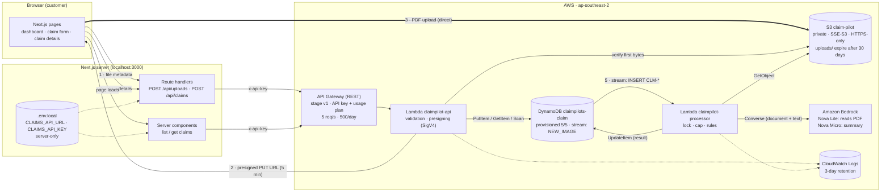

# ClaimPilot AI — Architecture

All AWS resources live in **ap-southeast-2 (Sydney)**. The portal runs locally (`npm run dev`); it is
**not deployed publicly**.

## Components



## Submission sequence

```mermaid
sequenceDiagram
  autonumber
  participant B as Browser
  participant N as Next.js server
  participant G as API Gateway
  participant A as claimpilot-api
  participant S as S3 (private)
  participant D as DynamoDB
  participant P as claimpilot-processor
  participant M as Bedrock

  B->>N: POST /api/uploads {name, size}
  N->>G: POST /uploads (x-api-key)
  G->>A: invoke
  A-->>B: presigned PUT (key, size, type locked; 300 s)
  B->>S: PUT PDF (direct, never via Next.js)
  B->>N: POST /api/claims {form + documentKey}
  N->>G: POST /claims
  G->>A: invoke
  A->>S: GET bytes 0-4 (exists? %PDF-? size?)
  A->>D: PutItem if not exists (claimId from upload ID)
  A-->>B: 201 claim (processing: pending), or 200 if replayed
  D-->>P: stream INSERT
  P->>D: lock pending → processing (conditional)
  P->>D: ADD usage counter (conditional cap)
  P->>S: GetObject PDF
  P->>M: Converse Nova Lite (PDF) → fields + quotes
  P->>P: rule checks (policy / date / amount)
  P->>M: Converse Nova Micro → explanation + "fits incident?"
  P->>D: save result (only if it still owns the lock)
  B->>N: claim page auto-refresh
  N->>G: GET /claims/{id}
  G->>A: invoke
  A-->>B: claim + customer-safe processing result
```

## Why it's shaped this way

| Decision | Reason |
|---|---|
| PDF goes browser → S3 with a presigned URL | Keeps documents off the web server; the URL allows one key, one size, one type, for 5 minutes. |
| Next.js server holds the API key | The browser never sees an AWS credential or the API key (`import "server-only"`). |
| REST API (not HTTP API) | API keys and usage plans give a hard daily quota as a cost guard. |
| SigV4 written by hand | Project rule: no AWS SDK. Verified against AWS-published signing examples. |
| Claim ID derived from the upload ID | One upload can only ever create one claim; identical retries return the stored claim. |
| DynamoDB Streams → separate processor | Processing starts only after the claim is saved; Lambda reads of the stream are free; the API stays fast. |
| Bedrock instead of Textract | Textract is denied on this Free-plan account by an AWS-managed service control policy (verified). |
| Rules decide; models only extract and explain | Deterministic comparisons; the model can never approve, reject or call fraud. |
